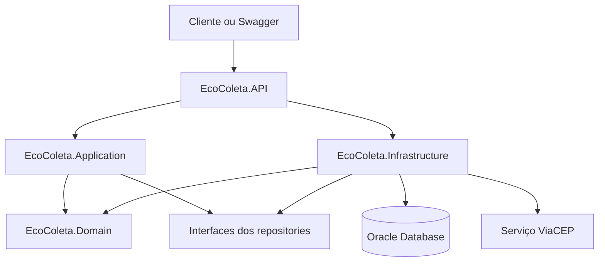

# EcoColeta - API de Pontos de Coleta

O **EcoColeta** é uma API para cadastro de pontos de coleta e agendamento de materiais recicláveis, desenvolvida com ASP.NET Core .NET 8.

A aplicação permite consultar pontos de coleta, cadastrar novos pontos, registrar usuários e agendar coletas de materiais. Usuários administradores podem cadastrar e excluir pontos e concluir coletas. Usuários comuns podem agendar e cancelar suas próprias coletas.

Projeto desenvolvido para o **CP5 de Advanced Business Development with .NET**.

## Integrante

| Nome | RM |
| --- | --- |
| Amandha Yumi Toyota Artulino | 563549 |

- Repositório público: `https://github.com/AmandhaYumi/CP5-EcoColeta.git`
- Vídeo de demonstração: `https://www.youtube.com/watch?v=LrcnoGg3lgY&feature=youtu.be`

## Tecnologias utilizadas

- .NET 8
- ASP.NET Core Web API com Controllers
- Entity Framework Core 8
- Oracle Database
- Clean Architecture
- Repository Pattern
- DTOs e mapeamento de respostas
- JWT Bearer Authentication
- Swagger / OpenAPI
- HttpClientFactory
- Polly para retry, timeout e circuit breaker
- xUnit
- WebApplicationFactory

## Arquitetura

O projeto segue uma organização inspirada em **Clean Architecture**, separando regras de negócio, casos de uso, infraestrutura e apresentação.

```text
EcoColeta.sln

src/
├── EcoColeta.Domain          Entidades e regras de negócio
├── EcoColeta.Application     Serviços, contratos, DTOs e resultados
├── EcoColeta.Infrastructure  Oracle, repositories, migrations e ViaCEP
└── EcoColeta.API             Controllers, autenticação e Swagger

tests/
├── EcoColeta.UnitTests
└── EcoColeta.IntegrationTests
```

### Domain

Contém as entidades, enums e regras essenciais do domínio:

- `PontoColeta`
- `Usuario`
- `Coleta`
- `TipoMaterial`
- `StatusColeta`

Essa camada não depende de banco de dados nem da API.

### Application

Contém os serviços da aplicação, contratos, DTOs e regras dos casos de uso. Também concentra o `OperationResult`, a paginação com `PageResult` e as interfaces dos repositories.

### Infrastructure

É responsável pelo acesso ao Oracle, pelo `DbContext`, pelas migrations, pelos repositories, pela autenticação e pela integração com o ViaCEP.

### API

É a camada de apresentação HTTP. Contém os Controllers, Swagger, autenticação JWT, autorização por perfil, tratamento global de erros e health check.

## Fluxo da aplicação



O Controller recebe a requisição e chama um serviço da camada Application. O serviço aplica as regras do caso de uso e utiliza interfaces de repository. A Infrastructure fornece as implementações que acessam o Oracle. Os Controllers não acessam diretamente o `DbContext`.

## Entidades principais

### PontoColeta

Representa um local onde os materiais podem ser entregues.

Principais propriedades:

```text
Id
Name
PostalCode
Street
City
State
```

O endereço é preenchido a partir do CEP informado usando o serviço externo ViaCEP.

### Usuario

Representa uma pessoa que utiliza a API.

Principais propriedades:

```text
Id
Email
PasswordHash
Role
```

Os perfis disponíveis são `Admin` e `Citizen`.

### Coleta

Representa um agendamento de coleta de material reciclável.

Principais propriedades:

```text
Id
CollectionPointId
UserId
Material
WeightKg
ScheduledAt
Status
```

Materiais disponíveis:

```text
Papel
Plastico
Vidro
Metal
Eletronicos
```

Status disponíveis:

```text
Agendada
Concluida
Cancelada
```

## Regras de negócio

- O nome do ponto de coleta é obrigatório e possui limite de tamanho.
- O CEP deve ser válido para a consulta do endereço.
- O peso da coleta deve ser maior que zero e limitado a 1000 kg.
- A data deve ser futura, estar em UTC e estar dentro dos próximos 30 dias.
- Uma coleta começa com status `Agendada`.
- Apenas coletas agendadas podem ser concluídas ou canceladas.
- O usuário comum só pode consultar e cancelar as próprias coletas.
- Apenas usuários com perfil `Admin` podem cadastrar pontos e concluir coletas.
- Conflitos de dados retornam `409 Conflict`.
- Dados inválidos retornam erros padronizados pelo `OperationResult`.

## Banco de dados

O projeto utiliza **Oracle Database**, que é o mesmo banco usado pela aplicação e pelos testes de integração.

As migrations ficam versionadas em `EcoColeta.Infrastructure/Migrations` e são aplicadas automaticamente quando a API é iniciada.

As credenciais devem ser configuradas fora do repositório, por variável de ambiente ou User Secrets.

Exemplo no PowerShell:

```powershell
$env:ConnectionStrings__Oracle = "Data Source=(DESCRIPTION=(ADDRESS_LIST=(ADDRESS=(PROTOCOL=TCP)(HOST=oracle.fiap.com.br)(PORT=1521)))(CONNECT_DATA=(SERVER=DEDICATED)(SID=ORCL)));User Id=SEU_USUARIO;Password=SUA_SENHA;"
```

## OperationResult e erros

As respostas da API seguem o padrão `OperationResult`, informando se a operação foi concluída, os dados retornados e o erro quando necessário.

Exemplo de erro:

```json
{
  "isSuccess": false,
  "data": null,
  "error": {
    "code": "auth.required",
    "message": "Token ausente, inválido ou expirado.",
    "kind": 3
  }
}
```

As regras de domínio usam erros customizados. Exceções de conflito do Oracle também são convertidas para respostas HTTP adequadas, como `409 Conflict`.

## Serviço externo e resiliência

Ao cadastrar um ponto, a API consulta o **ViaCEP** para obter rua, cidade e estado a partir do CEP.

A chamada usa `HttpClientFactory` e políticas de resiliência para lidar com instabilidade do serviço externo:

- Retry
- Timeout
- Circuit breaker

## Paginação e HATEOAS

As listagens usam `PageResult` e realizam a paginação diretamente no Oracle.

Exemplo:

```http
GET /api/pontos?pageNumber=1&pageSize=10
```

A resposta contém informações como quantidade total, número de páginas e os itens da página atual. Também são retornados links HATEOAS, como `self`, `collection`, `delete` e `agendar-coleta`, conforme o usuário autenticado.

## Autenticação e autorização

O cadastro e o login são feitos pelos endpoints:

```http
POST /api/auth/register
POST /api/auth/login
```

O login retorna um token JWT. No Swagger, o token deve ser informado pelo botão **Authorize**.

As permissões principais são:

| Ação | Usuário comum | Administrador |
| --- | --- | --- |
| Consultar pontos | Sim | Sim |
| Cadastrar ponto | Não | Sim |
| Agendar coleta | Sim | Sim |
| Cancelar própria coleta | Sim | Sim |
| Concluir coleta | Não | Sim |

Sem token, a API retorna `401 Unauthorized`. Quando o usuário está autenticado, mas não tem a permissão necessária, retorna `403 Forbidden`.

## Endpoints principais

| Método | Endpoint | Acesso | Descrição |
| --- | --- | --- | --- |
| POST | `/api/auth/register` | Público | Cadastra um usuário |
| POST | `/api/auth/login` | Público | Gera o token JWT |
| GET | `/api/pontos` | Público | Lista pontos com paginação |
| GET | `/api/pontos/{id}` | Público | Consulta um ponto |
| POST | `/api/pontos` | Admin | Cadastra um ponto |
| DELETE | `/api/pontos/{id}` | Admin | Remove um ponto |
| GET | `/api/coletas` | Autenticado | Lista coletas permitidas |
| GET | `/api/coletas/{id}` | Autenticado | Consulta uma coleta |
| POST | `/api/coletas` | Autenticado | Agenda uma coleta |
| PATCH | `/api/coletas/{id}/cancelar` | Proprietário ou Admin | Cancela uma coleta |
| PATCH | `/api/coletas/{id}/concluir` | Admin | Conclui uma coleta |
| GET | `/health` | Público | Verifica a saúde da API |

## Como executar

### Pré-requisitos

- .NET SDK 8
- Acesso ao Oracle da aplicação
- Credenciais configuradas por User Secrets ou variável de ambiente

### Restaurar e compilar

Na raiz do projeto:

```bash
dotnet restore
dotnet build --configuration Release
```

### Executar a API

```bash
dotnet run --project src/EcoColeta.API --launch-profile EcoColeta
```

Endereços disponíveis:

```text
API: http://localhost:5080
Swagger: http://localhost:5080/swagger
Health check: http://localhost:5080/health
```

## Testes automatizados

O projeto possui testes unitários e de integração:

```text
EcoColeta.UnitTests
EcoColeta.IntegrationTests
```

Para executar a suíte completa:

```bash
dotnet test --configuration Release
```

Os testes de integração usam o Oracle da aplicação e validam endpoints, migrations, autenticação, autorização, ViaCEP, resiliência, paginação, HATEOAS e conflitos.

## Conclusão

O EcoColeta organiza o cadastro de pontos e o agendamento de materiais recicláveis em uma API segura, com persistência Oracle, integração com serviço externo, tratamento padronizado de erros, paginação, HATEOAS, autenticação e autorização.
